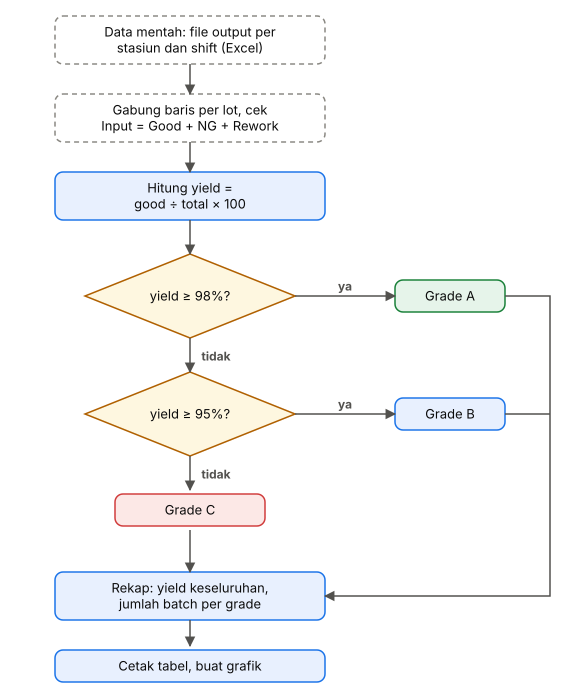
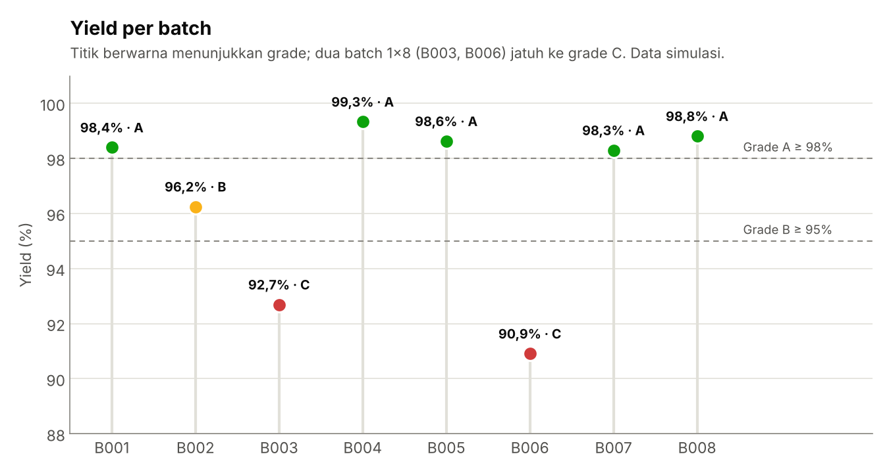
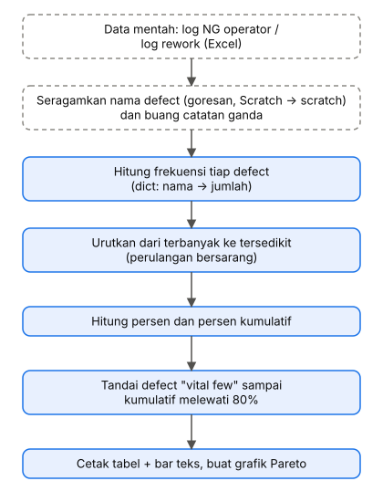
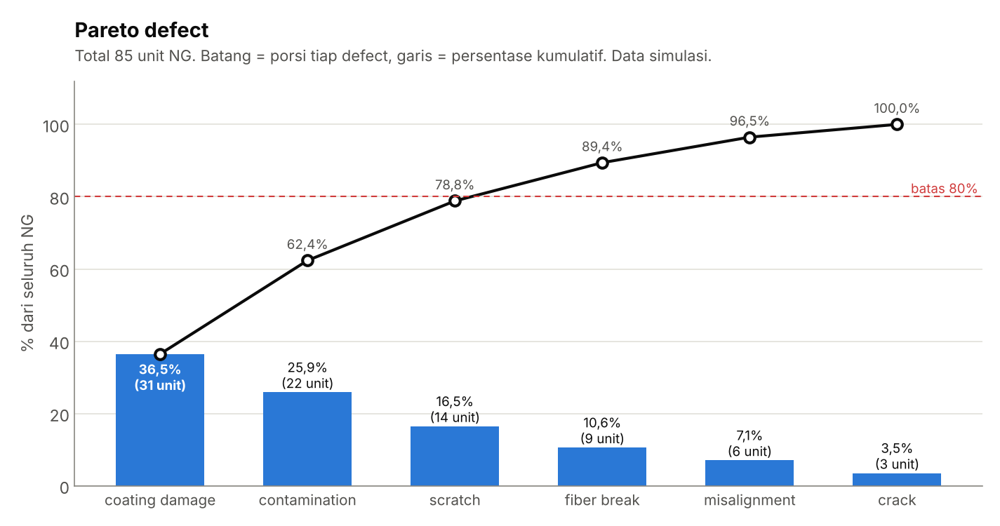
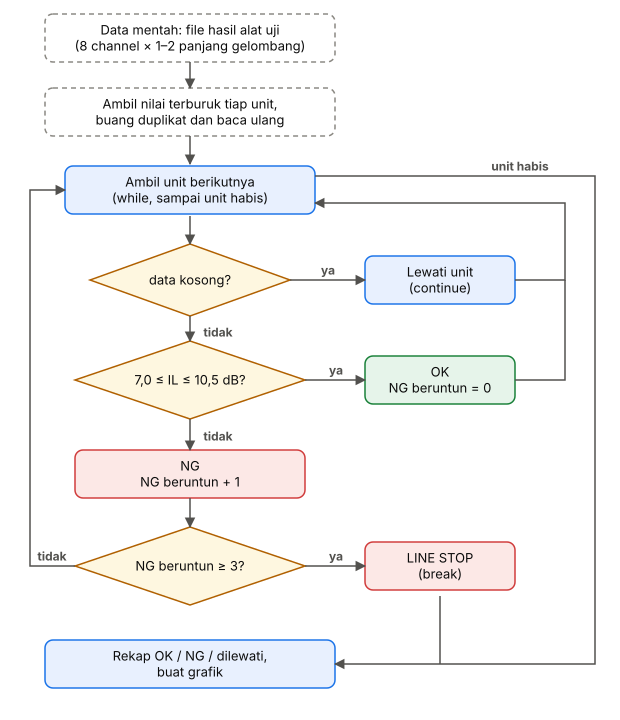
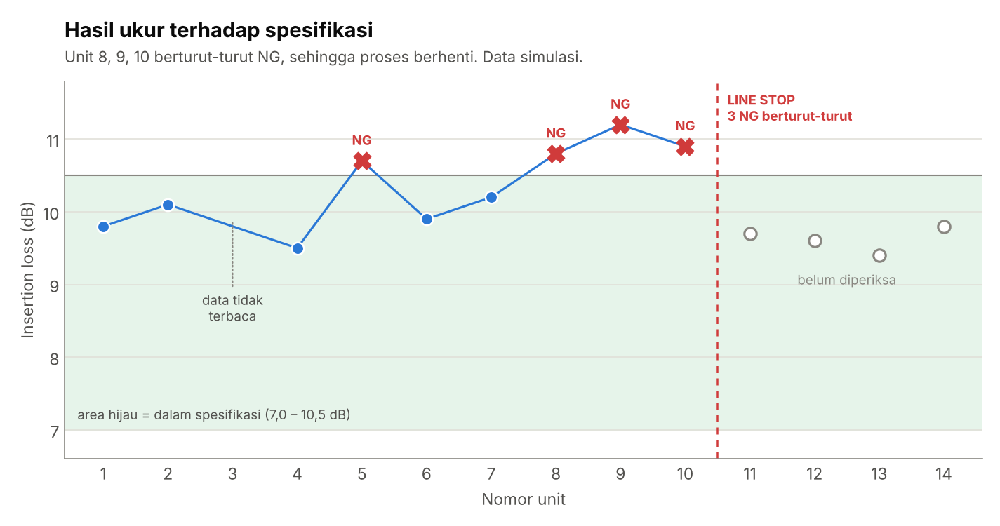

# Python-Mini-QC-Report

Tiga mini project Python berlatar manufaktur PLC Splitter, dibuat dari materi kursus DQLab *Python for Data Professional Beginner - Part 1*.

> Semua data adalah **simulasi (dummy)**, bukan data perusahaan. Batas spesifikasi dan batas grade hanyalah contoh.

- **Skrip inti** (`01`–`03`) hanya memakai materi Part 1 (tipe data, operator, percabangan, perulangan), tanpa library tambahan.
- **Grafik** (folder `grafik/`) memakai `matplotlib`, di luar materi Part 1, sebagai tambahan.

## Cara menjalankan

```
python 01_yield_grade.py          # skrip inti, Python 3.8+
pip install -r grafik/requirements.txt
cd grafik
python grafik_01.py               # gambar tersimpan di grafik/img/
```

## Project 1: Kalkulator Yield & Grade Batch

**Yang dilakukan:** Program ini menghitung yield dari 8 batch simulasi (jumlah unit good dibagi total), lalu memberi grade: A bila yield ≥ 98%, B bila ≥ 95%, selain itu C.

**Materi yang dipakai:** list, dict, set, if-elif-else, for

**Bentuk data awal di lapangan:** Laporan output per stasiun dan shift (Excel). Contoh ilustrasi, bukan data perusahaan.

| Tanggal | Shift | Operator | Stasiun | Lot | Model | Input | Good | NG | Rework |
|---|---|---|---|---|---|---|---|---|---|
| 06/11 | 1 | OP-07 | Coupling | L2611A | 1x8 | 120 | 112 | 6 | 2 |
| 06/11 | 2 | OP-12 | Coupling | L2611A | 1x8 | 130 | 125 | 5 | 0 |
| 06/11 | 1 | OP-03 | Enkap | L2611A | 1x8 | 112 | 108 | 4 | 0 |

Masalah umum:

- Satu lot tersebar di beberapa baris, stasiun, dan shift, jadi yield harus digabung per lot.
- Unit rework bisa terhitung dua kali.
- Input tidak selalu sama dengan good + NG + rework.
- Penulisan ID lot atau model tidak seragam.

Beda dengan mini project: Data sudah satu baris per batch dan bersih.

**Alur pekerjaan:** kotak biru dikerjakan skrip mini project, kotak putus-putus adalah pekerjaan lapangan di luar skrip.



**Kode:** [`01_yield_grade.py`](01_yield_grade.py)

**Output:**
```
Batch  Produk   Total   Good  Yield %  Grade
--------------------------------------------
B001   1x8        500    492    98.40  A
B002   1x4        480    462    96.25  B
B003   1x8        520    482    92.69  C
B004   1x2        450    447    99.33  A
B005   1x4        510    503    98.63  A
B006   1x8        495    450    90.91  C
B007   1x2        470    462    98.30  A
B008   1x8        505    499    98.81  A
--------------------------------------------
Yield keseluruhan : 96.62% (3797/3930)
Jumlah batch/grade: {'A': 5, 'B': 1, 'C': 2}
Jenis produk      : ['1x2', '1x4', '1x8']
```

**Grafik:** [`grafik/grafik_01.py`](grafik/grafik_01.py)



**Kesimpulan:** Yield keseluruhan 96,62% (3.797 dari 3.930 unit). Hasilnya 5 batch grade A, 1 batch grade B, dan 2 batch grade C. Kedua batch grade C (B003 dan B006) adalah produk 1x8, jadi pada data simulasi ini 1x8 yang perlu diperiksa lebih dulu.

## Project 2: Pareto Defect Versi Teks

**Yang dilakukan:** Program ini menghitung berapa kali tiap jenis defect muncul dari 85 unit NG, mengurutkannya dari yang terbanyak, lalu menghitung persentase kumulatif untuk menemukan defect yang menyumbang sekitar 80% masalah.

**Materi yang dipakai:** dict, for bersarang, operator in, string × angka

**Bentuk data awal di lapangan:** Log NG operator atau log rework (Excel). Contoh ilustrasi, bukan data perusahaan.

| Tanggal | Stasiun | Lot | Serial | Defect (ketikan operator) | Qty | Catatan |
|---|---|---|---|---|---|---|
| 06/11 | Coating | L2611A | 0034 | goresan | 1 |   |
| 06/11 | Coating | L2611A | 0051 | coating rusak | 1 | ada kotoran juga |
| 07/11 | Enkap | L2611B | 0102 | Scratch | 1 |   |
| 07/11 | Enkap | L2611B | 0102 | Scratch | 1 |   |

Masalah umum:

- Nama defect tidak seragam (goresan, scratch, Scratch, scrch), jadi harus dipetakan ke satu daftar baku.
- Satu unit bisa punya beberapa defect, dan catatan bisa terduplikasi (serial 0102 di atas).
- Kolom defect kosong atau diisi "lain-lain".
- Unit yang sama dicatat lagi setelah rework.

Beda dengan mini project: Nama defect sudah seragam dan satu baris sama dengan satu unit NG.

**Alur pekerjaan:** kotak biru dikerjakan skrip mini project, kotak putus-putus adalah pekerjaan lapangan di luar skrip.



**Kode:** [`02_pareto_defect.py`](02_pareto_defect.py)

**Output:**
```
Defect            Jml      %   Kum %  Bar
------------------------------------------------------------
coating damage     31   36.5    36.5  ██████████████████ <- vital few
contamination      22   25.9    62.4  █████████████ <- vital few
scratch            14   16.5    78.8  ████████ <- vital few
fiber break         9   10.6    89.4  █████ <- vital few
misalignment        6    7.1    96.5  ████
crack               3    3.5   100.0  ██
------------------------------------------------------------
Total NG: 85 unit
```

**Grafik:** [`grafik/grafik_02.py`](grafik/grafik_02.py)



**Kesimpulan:** Coating damage (36,5%) dan contamination (25,9%) bersama menyumbang 62,4% dari seluruh NG. Dengan scratch, tiga jenis teratas mencapai 78,8%, dan fiber break membawa total melewati 80% (89,4%). Perbaikan sebaiknya dimulai dari empat defect teratas.

## Project 3: Pemeriksa Spesifikasi & Line Stop

**Yang dilakukan:** Program ini memeriksa 14 hasil ukur insertion loss terhadap spesifikasi 7,0 sampai 10,5 dB. Data yang tidak terbaca dilewati, dan proses berhenti otomatis bila ditemukan 3 unit NG berturut-turut.

**Materi yang dipakai:** tuple, while, break, continue, and / or

**Bentuk data awal di lapangan:** File hasil alat uji optik (CSV atau TXT). Contoh ilustrasi, bukan data perusahaan.

| Serial | Waktu | Ch | Panjang gelombang (nm) | IL (dB) | RL (dB) | Hasil |
|---|---|---|---|---|---|---|
| 0034 | 09:14:02 | 1 | 1310 | 9,8 | 55,2 | PASS |
| 0034 | 09:14:02 | 2 | 1310 | 10,1 | 54,8 | PASS |
| … | … | 3–8 | … | … | … | … |
| 0035 | 09:15:10 | 1 | 1310 | (kosong) | (kosong) | ERROR |

Masalah umum:

- Satu unit 1x8 menghasilkan banyak baris (8 channel, kadang dua panjang gelombang), jadi hasil unit ditentukan dari channel terburuk.
- Ada baris kosong atau error baca saat konektor tidak terpasang baik.
- Bisa ada pengukuran ulang atau serial ganda.
- Spesifikasi berbeda per produk dan per panjang gelombang.

Beda dengan mini project: Satu unit hanya punya satu nilai, dan data gagal baca diwakili `None`.

**Alur pekerjaan:** kotak biru dikerjakan skrip mini project, kotak putus-putus adalah pekerjaan lapangan di luar skrip.



**Kode:** [`03_spec_check.py`](03_spec_check.py)

**Output:**
```
Unit  1:   9.8 dB  OK
Unit  2:  10.1 dB  OK
Unit  3: (tidak terbaca, dilewati)
Unit  4:   9.5 dB  OK
Unit  5:  10.7 dB  NG
Unit  6:   9.9 dB  OK
Unit  7:  10.2 dB  OK
Unit  8:  10.8 dB  NG
Unit  9:  11.2 dB  NG
Unit 10:  10.9 dB  NG
>>> LINE STOP: 3 NG berturut-turut pada unit 10
----------------------------------------
OK: 5 | NG: 4 | Dilewati: 1
Proses dihentikan di unit 10; 4 unit belum diperiksa.
```

**Grafik:** [`grafik/grafik_03.py`](grafik/grafik_03.py)



**Kesimpulan:** Proses berhenti di unit 10 karena unit 8, 9, dan 10 berturut-turut NG. Hasil sampai titik itu: 5 OK, 4 NG, 1 data dilewati, dan 4 unit belum diperiksa.

## Ringkasan materi Part 1

- **Struktur program:** statement, variable, literal, operator.
- **Tipe data:** `None`, `bool`, `int`, `float`, `str`; `list`, `tuple`, `set`, `frozenset`, `dict`.
- **Operator:** aritmetika, assignment, perbandingan, logika, identitas (`is`), keanggotaan (`in`).
- **Prioritas operator:** `()` → `**` → `* / // %` → `+ -` → perbandingan → `not and or`.
- **Alur program:** if-elif-else, while, for, break, continue, nested loop.

Latihan dasar (6 latihan) ada di [`python_dasar_latihan.py`](python_dasar_latihan.py).

## Langkah berikutnya

Project analisis dengan pandas dan SQL ada di [portofolio](https://bagusbernadi.github.io/).
